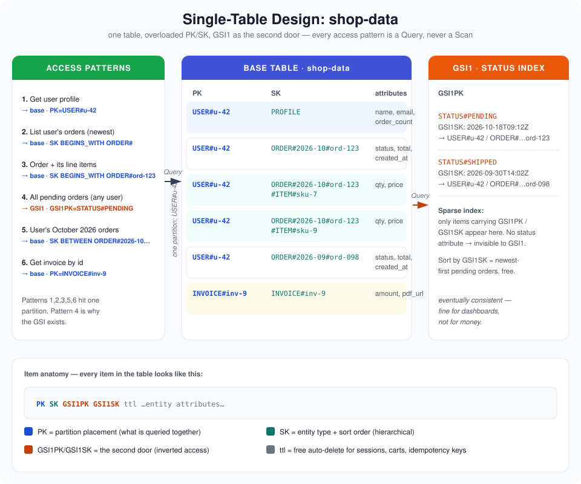

# DynamoDB Data Modeling Guide

[](https://aws.amazon.com/dynamodb/)
[](dynamodb_single_table.py)
[](.)
[](quiz.md)

> **TL;DR** — DynamoDB doesn't care about your entities; it cares about your *access patterns*. List every query your app will run *before* you design the table, then stuff related entities into ONE table using overloaded `PK`/`SK` attributes. One query = one partition hit = single-digit millisecond latency. [`dynamodb_single_table.py`](dynamodb_single_table.py) builds a complete single-table shop schema (users, orders, line items) and runs all 6 access patterns against it.

---

## Architecture



Every item lives in the same table. The `PK` decides *where* the data lives; the `SK` decides *what* it is. Queries never `Scan()` — they ask for one partition and walk its sort keys.

## The 30-second mental model

| Piece | Job | In this guide |
|---|---|---|
| **PK (partition key)** | Groups items that are queried together | `USER#42` owns the user profile *and* all their orders |
| **SK (sort key)** | Orders items and encodes entity type | `ORDER#2026-10#ord-123` — type, date, id in one string |
| **Attribute overloading** | One table, many entity shapes | Profile, order, and line item all share `PK`/`SK` but carry different fields |
| **GSI (global secondary index)** | A second door into the same data | `GSI1` flips the keys: query *all orders by status* |
| **Sparse index** | Only items with the indexed attributes appear | Shipped orders don't carry `GSI1SK` → invisible to the "pending orders" index |

## Design workflow — patterns first, schema last

```
1. Write down every access pattern ("get user", "list orders by user", ...)
   │
2. For each pattern, sketch the PK + SK that answers it in ONE query
   │
3. Merge: overload one table's PK/SK so every pattern is covered
   │
4. Whatever a pattern can't reach on the base keys → add a GSI
   │
5. Size it: on-demand for spiky, provisioned + autoscaling for steady
```

Skip step 1 and you'll model a relational schema in DynamoDB, then wonder why everything needs a `Scan()`.

## The access pattern table (the actual design)

| # | Access pattern | Key used | Expression |
|---|---|---|---|
| 1 | Get user profile | Base | `PK = USER#42`, `SK = PROFILE` |
| 2 | List a user's orders (newest first) | Base | `PK = USER#42`, `SK BEGINS_WITH ORDER#` |
| 3 | Get one order with its line items | Base | `PK = USER#42`, `SK BEGINS_WITH ORDER#ord-123` |
| 4 | List *all* pending orders (any user) | GSI1 | `GSI1PK = STATUS#PENDING` |
| 5 | Orders placed in October 2026 by a user | Base | `PK = USER#42`, `SK BETWEEN ORDER#2026-10 AND ORDER#2026-10￿` |
| 6 | Get an invoice by its id | Base | `PK = INVOICE#inv-9`, `SK = INVOICE#inv-9` |

Pattern 4 is why the GSI exists: no base-key query can reach "all pending orders" without scanning. The inverted index (`GSI1PK = status`, `GSI1SK = created_at`) makes it a single query.

## Single-table vs one-table-per-entity

| | One table per entity (RDBMS habit) | Single table |
|---|---|---|
| Queries per screen | N (one per table) + application joins | 1 (everything adjacent in the partition) |
| Latency | Adds up with every round trip | One partition hit, single-digit ms |
| New access pattern | New query | Maybe a new GSI — or a key you already have |
| Mental cost | Low at first, painful forever | High up front (think in queries, not tables) |
| Throughput cost | Each table needs its own capacity | Shared capacity, but hot partitions bite harder |

**Rule of thumb:** if two entities are fetched in the same request, they belong in the same partition. DynamoDB stores data the way you *read* it, not the way the real world is shaped.

## Key-building blocks you'll reuse everywhere

| Block | Shape | Example |
|---|---|---|
| **Entity prefix** | `ENTITY#id` | `USER#42`, `ORDER#ord-123` |
| **Hierarchical SK** | `PARENT#id#CHILD#id` | `ORDER#ord-123#ITEM#sku-7` |
| **Date bucket** | `YYYY-MM#` prefix in SK | `ORDER#2026-10#ord-123` — keeps hot months tight, enables `BETWEEN` |
| **Status in GSI** | `STATUS#VALUE` as `GSI1PK` | `STATUS#PENDING` → all pending orders in one query |
| **Inverted item** | Swap base/GSI roles | The GSI is the "table" for admin queries |
| **Materialized count** | Counter attribute on the parent | `order_count` on the user profile, updated with `ADD` — never `Scan()` to count |

## Quick start

```python
from dynamodb_single_table import ShopStore

store = ShopStore()                      # in-memory; swap for boto3 Table in prod
store.seed()                             # user, 3 orders, 6 line items

profile = store.get_user_profile("u-42")               # pattern 1
orders  = store.list_user_orders("u-42")               # pattern 2 (newest first)
detail  = store.get_order("u-42", "ord-123")           # pattern 3 (order + items)
pending = store.list_orders_by_status("PENDING")       # pattern 4 (via GSI1)
```

Run the local demo — no AWS credentials needed:

```bash
python dynamodb_single_table.py
```

It seeds the table, runs all six access patterns, and prints the exact `PK`/`SK` each query hits. The boto3 equivalents (real `Table.query` calls) are annotated in each method.

## Capacity & cost in 60 seconds

| Mode | You pay for | Best when |
|---|---|---|
| **On-demand** | Per request | Spiky, unknown, or new workloads |
| **Provisioned + autoscaling** | Reserved RCU/WCU that scale with traffic | Steady, predictable traffic — cheaper at scale |

Watch these like a hawk:
- **Hot partitions** — one `PK` eating most of your throughput throttles while capacity sits idle elsewhere. Date buckets and sharded keys (`ORDER#<shard>#...`) spread the heat.
- **GSI write cost** — every GSI doubles (or worse) your write cost on indexed items. Only index patterns that matter.
- **Item size** — 400 KB max, and big items eat RCU/WCU. Keep images/files in S3, pointers in DynamoDB.

## Common gotchas

1. **Modeling entities first, queries never** → you get pretty items and a `Scan()` on every page load. Write the access patterns first. Always.
2. **"I'll just Scan, the table is small"** → tables stop being small. `Scan()` reads every item and bills you for it. Design so you never need one.
3. **GSI for everything** → each GSI multiplies write cost and eventually-consistent reads. If a pattern is rare, a targeted scan of *one partition* beats a GSI.
4. **Timestamps as bare SK** → `1699999999` tells a query nothing. Put the entity type and date bucket in the key: `ORDER#2026-10#ord-123`.
5. **No TTL** → sessions, carts, and idempotency records live forever and you pay forever. Set `ttl` and let DynamoDB delete them for free.
6. **Update without condition** → two writers racing silently clobber each other. `ConditionExpression` is your optimistic lock; use it on anything that matters.

## Contents

| File | What it is |
|---|---|
| `README.md` | This guide |
| `architecture.svg` | Single-table layout + GSI routing diagram |
| `dynamodb_single_table.py` | Full single-table shop schema with 6 access patterns (runnable demo) |
| `quiz.md` | 5-question self-test with answers |

## Quiz teaser

> Your product page needs the user profile, their last 5 orders, and each order's line items. On the single-table design in this guide, how many DynamoDB queries does that page need — and which key expressions are they? 🤔
>
> Answer in [`quiz.md`](quiz.md) — no peeking!

---

Built as part of a daily cloud-engineering series. Star it if it saved you a Scan(). ⭐
